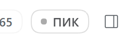
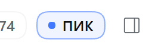

# dsh-peak-guard

Peak-hour guard for DeepSeek Harness. DeepSeek bills peak hours at double rate; this plugin
watches that schedule and steers a short notice into a Session you switched it on for: once
when the peak starts, and once when it ends.

## What it does



- **Per-Session switch.** A small `PEAK` chip in the Session header. Nothing happens until
  you click it; a new Session always starts switched off.
- **Peak start.** If the Session is actually working, the agent gets a steering message:
  the peak is running until *hh:mm*, pause what can wait, finish only what is nearly done,
  say briefly where you stopped.
- **Peak end.** The agent gets a message to continue what it paused. A sleeping Session is
  woken for it — that is the point of the switch.

Switched on, the chip turns blue and shows the end of the running peak:



The plugin never cancels the agent's work, never touches sub-agents, and never counts money.

## Schedule source

The peak schedule is read from the [dsh-pricing](https://github.com/machine202502/dsh-pricing)
bridge (`http://127.0.0.1:49237/state`), which fetches and validates DeepSeek's official
pricing page. If that plugin is off, the built-in `fallbackPeak` window is used and the log
says `source=fallback`.

As of the current page the peak is `01:00–04:00` and `06:00–10:00 UTC, Monday through
Friday`; everything else, weekends included, is off-peak.

## Install

```sh
dsh plugin add @machine202502/dsh-peak-guard@link:C:/shared-data/reps/dsh-plugins/dsh-peak-guard
```

Then enable the bundle in **Plugins** and click the `PEAK` chip in the Session header.

## Configuration

The plugin has a settings card on the Plugins page: it switches the language.

| Key | Default | Meaning |
|---|---|---|
| `bridgePort` | `49238` | Loopback port the chip talks to |
| `pricesUrl` | `http://127.0.0.1:49237/state` | Where the peak schedule comes from |
| `language` | `ru` | `ru`, `en`, `zh`, or `auto` |
| `debugWindows` | `null` | `[{ "from": "12:00", "to": "12:02" }]` — forces a window for testing |
| `debugTz` | `null` | Zone for `debugWindows`, default `fallbackPeak.tz` |
| `fallbackPeak` | UTC, Mon–Fri, 01–04 and 06–10 | Schedule used when the bridge is unavailable |

## Languages

Three languages: Russian, English, Chinese. The order is: the plugin setting → `auto`
(follows the application language: `ru*` → `ru`, `zh*` → `zh`, otherwise `en`) → `ru`.

- Strings live in the code (`STRINGS.ru|en|zh` in `client.js`, `TEXT` in `index.js`).
- Plugin name and description come from `locale/ru.json`, `locale/en.json`, `locale/zh.json`.
- The setting is stored in `%LOCALAPPDATA%\dsh-peak-guard\settings.json` and is changed
  through the settings card; a change applies without restarting Harness.

## Known limits

- Chinese public holidays are not in the schedule (`holidays: []`), so on a holiday the
  notice may arrive when the real price is off-peak.
- The notice goes to the root Session only; sub-agents inherit it as part of the work.
- If Harness is closed when the peak ends, the resume is delivered on the next start —
  unless a newer peak is already running, in which case the stale resume is dropped.

MIT.
