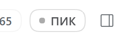
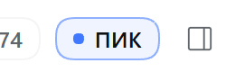

# dsh-peak-guard

Сторож пикового тарифа для DeepSeek Harness. В пиковые часы DeepSeek берёт вдвое дороже;
плагин следит за этим расписанием и подкидывает в сессию короткое уведомление — один раз
на старте пика и один раз на его конце.

## Что делает



- **Переключатель в сессии.** Маленький чип `ПИК` в шапке сессии. Пока не нажмёшь — тишина;
  новая сессия всегда начинается выключенной.
- **Начало пика.** Если сессия реально работает, агенту приходит steering-сообщение:
  пик до *чч:мм*, приостанови то, что может подождать, доведи только почти готовое,
  коротко скажи, на чём остановился.
- **Конец пика.** Агенту приходит сообщение продолжить приостановленное. Спящую сессию
  плагин будит — в этом и смысл переключателя.

Включённый чип синеет и показывает, до какого времени идёт текущий пик:



Плагин никогда не отменяет работу агента, не трогает субагентов и не считает деньги.

## Откуда расписание

Из бриджа [dsh-pricing](https://github.com/machine202502/dsh-pricing)
(`http://127.0.0.1:49237/state`), который тянет и валидирует официальную страницу цен.
Если тот плагин выключен, берётся встроенное окно `fallbackPeak`, а в лог пишется
`source=fallback`.

По текущей странице пик — `01:00–04:00` и `06:00–10:00 UTC, понедельник–пятница`;
всё остальное, включая выходные целиком, — вне пика.

## Установка

```sh
dsh plugin add @machine202502/dsh-peak-guard@link:C:/shared-data/reps/dsh-plugins/dsh-peak-guard
```

Дальше включить bundle в разделе **Plugins** и нажать чип `ПИК` в шапке сессии.

## Настройки

У плагина есть карточка настроек на странице Plugins: в ней переключается язык.

| Ключ | По умолчанию | Смысл |
|---|---|---|
| `bridgePort` | `49238` | Локальный порт, с которым говорит чип |
| `pricesUrl` | `http://127.0.0.1:49237/state` | Откуда берётся расписание пика |
| `language` | `ru` | `ru`, `en`, `zh` или `auto` |
| `debugWindows` | `null` | `[{ "from": "12:00", "to": "12:02" }]` — принудительное окно для проверки |
| `debugTz` | `null` | Зона для `debugWindows`, по умолчанию из `fallbackPeak` |
| `fallbackPeak` | UTC, Пн–Пт, 01–04 и 06–10 | Расписание на случай недоступного бриджа |

## Языки

Три языка: русский, английский, китайский. Порядок выбора: настройка плагина →
`auto` (язык приложения: `ru*` → `ru`, `zh*` → `zh`, иначе `en`) → `ru`.

- Строки интерфейса — в коде (`STRINGS.ru|en|zh` в `client.js`, `TEXT` в `index.js`).
- Название и описание плагина — из `locale/ru.json`, `locale/en.json`, `locale/zh.json`.
- Настройка хранится в `%LOCALAPPDATA%\dsh-peak-guard\settings.json` и меняется через
  карточку настроек; смена применяется без перезапуска Harness.

## Известные ограничения

- Китайские праздники в расписании не учтены (`holidays: []`), поэтому в праздник
  уведомление может прийти, когда реально действует половинный тариф.
- Уведомление идёт только в корневую сессию; субагенты получают его как часть работы.
- Если Harness закрыт в момент конца пика, продолжение придёт при следующем запуске —
  кроме случая, когда уже идёт новый пик: тогда просроченное продолжение отбрасывается.

MIT.
